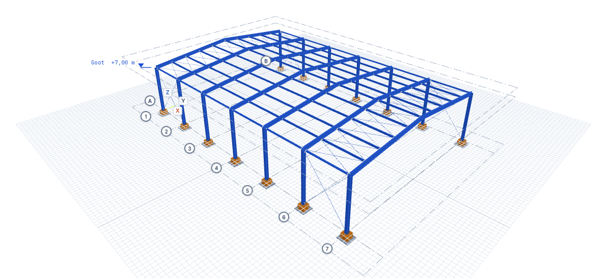
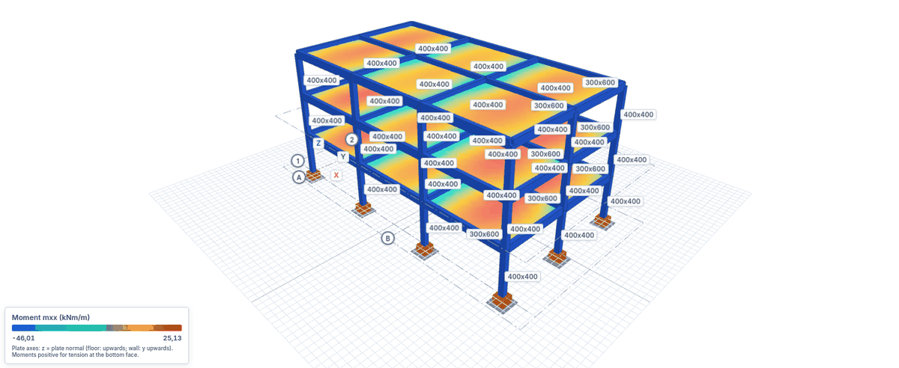
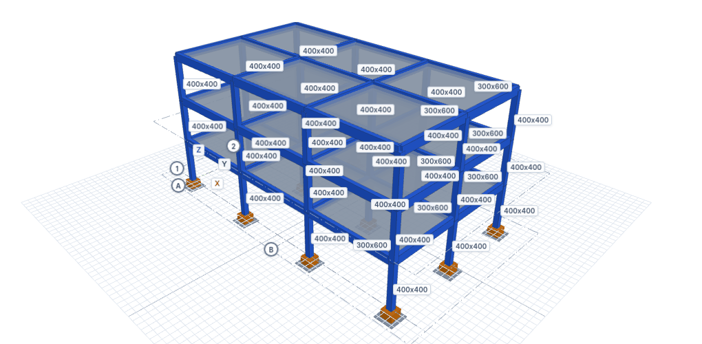
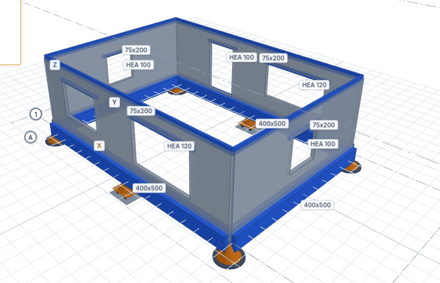
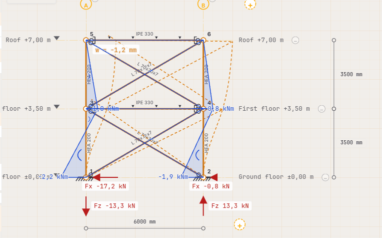
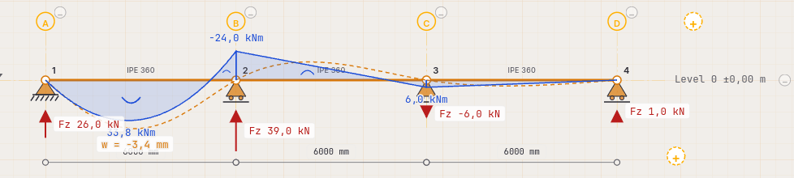

<p align="center">
  <strong>Open FEM Studio Mechanics</strong>
</p>

<p align="center">
  Open-source finite element program (2D and 3D) for structural mechanics.<br>
  Part of the <a href="https://github.com/OpenAEC-Foundation">OpenAEC Foundation</a> portfolio.
</p>

<p align="center">
  <a href="LICENSE.md"></a>
  
  
</p>

> [!WARNING]
> **Alpha version: not suitable for production calculations.**
> Open FEM Studio Mechanics is under heavy development. The solvers and the report may contain errors and may
> change between versions. Do not use the results as the basis for structural calculations in real projects,
> and always verify them with an independent calculation.

Open FEM Studio Mechanics is a desktop application (Windows, macOS, Linux) for modelling and analysing
structures: frames, trusses, beams and plates in 2D, and frames with shells, slabs and walls in 3D. It computes
internal forces, displacements, support reactions and plate results for load cases and load combinations, and
writes a calculation report. The user interface is available in English, Dutch, German and French.

This is the **mechanics edition** of Open FEM Studio: everything needed to model, load and analyse a structure,
without code checking (no Eurocode member checks or unity checks). The results are the starting point for your
own checks.

---

## Gallery

The images below were made with the app from the [example projects](#example-projects) in [`examples/`](examples/).
All structures are fictitious.

| | |
|:---:|:---:|
|  |  |
| **Steel hall** from the hall wizard: portal frames, purlins and tension-only bracing | **Concrete office**: slab bending moments m<sub>xx</sub> (shell elements) in an ULS combination |
|  |  |
| **Concrete office**: columns, beams and floor slabs | **Masonry house**: calcium silicate walls with openings and steel lintels on foundation beams |
|  |  |
| **Braced frame (2D)** under wind: the compressed tension-only diagonals drop out | **Continuous beam (2D)**: bending moment, deflection and reactions for the imposed load on the first span only |

## Features

**Modelling**

- **2D**: beams, frames and trusses, plus plates loaded in their plane (wall plates); grids and levels,
  member end releases and springs, tapered members, tension-only members, elastic supports and bedding
- **3D**: frames with shell elements for slabs and walls, load panels that distribute area loads to the
  supporting beams, tension-only members, rigid diaphragms, elastic bedding under beams and plates, member end
  releases, tapered members, and masonry walls with openings and lintels
- Profile library (HEA, HEB, HEM, IPE, UNP, UPE, RHS, SHS, CHS, angles, round and flat bars and more) with
  section properties, a cross-section editor for your own sections, and materials (steel, concrete, timber,
  CLT, aluminium and user-defined)
- A steel hall wizard that generates a complete hall (frames, purlins, eaves beams, roof and wall bracing,
  loads, optionally a concrete foundation grid on piles)

**Loads and combinations**

- Load cases with point loads and moments, line and trapezoidal loads, plate edge loads, area loads (3D), self-weight and temperature loads
- Wind and snow load generators
- Load combinations to EN 1990 (generated per consequence class with the Dutch national annex) or your own,
  pattern loading, envelopes

**Analysis**

- Linear and geometrically non-linear second-order analysis (P-Δ), initial sway imperfections, elastic
  critical load factor α<sub>cr</sub> and buckling modes
- 2D solver in TypeScript (bar, triangle, quadrilateral and DKT plate elements); 3D frame and shell analysis
  through a pinned version of an external Rust engine; experimental native Rust kernels for plates and volumes
- Results: internal force diagrams (N, V, M, torsion), deformed shape, displacements, support reactions,
  plate stresses and moments, contour plots

**Input and output**

- Calculation report (input, loads, combinations, diagrams, reactions, displacements, plate results), printable
  to PDF
- Project files `.ifcfem` (older `.ifcfem2d` files still open)
- IFC4 export of the analysis model together with the physical model, and `.ifcfemresults`: an IFC4 file with
  the analysis results and the project embedded
- Import of IFC4 structural analysis models into the 3D model
- Local import extensions for other file formats

**Automation**

- An MCP server (`openaec-mcp-server`) ships with the app. An AI assistant such as Claude Desktop or Claude Code
  can use it to run the solvers directly, edit `.ifcfem` project files without the app, and drive the running
  app: build models, solve, take screenshots and export reports
- Every command of the app's command register (`model3d.*`, `project.*`) is available as an MCP tool

## Example projects

Open any of these files with **File → Open** in the app. They are fictitious structures made to show what the
program can do, with common profiles and the standard load combinations of NEN-EN 1990 (consequence class CC2).

| File | Model | Shows |
|---|---|---|
| [`steel-hall.ifcfem`](examples/steel-hall.ifcfem) | 3D steel hall 36 × 24 m, eaves height 7 m, 6° duopitch roof; HEA 400 columns and IPE 500 rafters, IPE 220 purlins, RD 24 bracing | Hall wizard, tension-only bracing, snow and wind cases |
| [`glulam-portal-hall.ifcfem`](examples/glulam-portal-hall.ifcfem) | 3D glulam (GL24h) portal frames, span 12 m, five frames at 5 m, pinned purlins, RD 20 steel rod bracing | Load panels on a pitched roof, tension-only cross bracing, longitudinal wind |
| [`concrete-office.ifcfem`](examples/concrete-office.ifcfem) | 3D concrete frame, three storeys of 3.6 m, grid 3 × 7.2 m by 2 × 6.0 m; 400 × 400 columns, 300 × 600 beams, 250 mm slabs | Shell elements for slabs, area loads, office imposed load, wind on the facade |
| [`masonry-house.ifcfem`](examples/masonry-house.ifcfem) | 3D house 8.4 × 6.0 m with 120 mm calcium silicate walls, window openings with HEA 100/120 lintels, 400 × 500 concrete foundation beams on piles | Masonry walls (orthotropic shells) with lintels |
| [`continuous-beam-2d.ifcfem`](examples/continuous-beam-2d.ifcfem) | 2D continuous IPE 360 beam over three spans of 6 m | One imposed load case per span (pattern loading) in the standard combinations |
| [`braced-frame-2d.ifcfem`](examples/braced-frame-2d.ifcfem) | 2D two-storey steel frame, one bay of 6 m; HEA 200 columns, IPE 330 beams with pinned ends, L 70x70x7 cross bracing | Tension-only bracing under wind |

## Installation

Download the installer for your platform from the
[Releases](https://github.com/OpenAEC-Foundation/open-fem-studio-mechanics/releases) page:

- **Windows:** `.exe` (NSIS installer) or `.msi`
- **macOS:** `.dmg` (universal)
- **Linux:** `.AppImage` or `.deb`; signatures (`.asc`) and checksums (`SHA256SUMS`) are published alongside

The installers also place the MCP server next to the app. To connect an AI assistant, open
**Settings → AI assistant (MCP)** in the app: it shows the path of the server, a button to add it to Claude
Desktop, and the command for Claude Code. Driving the running app is only possible on the same computer and
can be switched off there. See the [MCP server README](src-tauri/crates/openaec-mcp-server/README.md) for all
tools.

## Building from source

Requirements: Node.js 22, the Rust toolchain via [rustup](https://rustup.rs/), and on Windows the WebView2
runtime. On Linux you also need the development packages for GTK 3, WebKitGTK 4.1 and Cairo.

```bash
npm install                                  # root: the Tauri CLI
npm --prefix design-mockup install           # the frontend

# from the repository root:
npm run tauri:dev     # desktop app in development mode (dev server on port 1440)
npm run tauri:build   # installer; also builds the frontend and the MCP server
```

### Repository layout

| Path | Contents |
|---|---|
| `design-mockup/` | **The application.** React 19, TypeScript, Vite 7, zustand, i18next. The folder name is historical. |
| `design-mockup/src/core/` | The 2D FEM core in TypeScript (bar, triangle, quadrilateral and DKT elements; linear and second-order solvers; plate mesher) |
| `src-tauri/` | Tauri v2 desktop shell and the Rust workspace |
| `src-tauri/crates/` | `mechanics` and `section-properties` (cross-section analysis), `steel-profiles` (profile library), `open-fem-3d` and `frame3d-solver` (3D engine adapters), `native-fem` (native Rust kernels), `toetsbrug` (the Rust kernels as JSON over stdin/stdout for the browser dev server) and `openaec-mcp-server` |
| `vendor/dedaliano-engine/` | The pinned external 3D engine with Open FEM extensions |
| `examples/` | Example projects |

### Tests

```bash
cd src-tauri
cargo build --release -p toetsbrug -p openaec-mcp-server -p open-fem-3d   # the JS tests call these binaries
cargo build -p toetsbrug -p open-fem-3d -p frame3d-solver -p openaec-native-fem --bins

cd ../design-mockup
npx tsc --noEmit
node scripts/run-tests.mjs            # all test-*.mjs against the source
node scripts/run-tests.mjs --bundel   # adapter tests against the solver bundle

cd ../src-tauri
cargo test --workspace --exclude open-fem-studio
```

The solver tests are set up analytically: each compares the program with a closed-form solution or a published
benchmark. After a change to the solver core or `engine.ts`, rebuild the MCP solver bundle with
`npm run build:sidecar` in `design-mockup/`.

## Versioning

Versions follow the OpenAEC Blueprint scheme **YYYY.W.N**: year, ISO week (no leading zero) and a sequence
number within that week starting at 0, for example `2026.44.0`. Git tags are `vYYYY.W.N`; a tag starts the
release workflow, which builds the installers and publishes a draft release. `npm run versie` shows and checks
every place where the number is stored (`npm run versie -- --set 2026.44.1` changes them all).

## License

| Part | License |
|---|---|
| Open FEM Studio Mechanics as a whole: the app (`design-mockup/`, `src-tauri/`), toetsbrug, MCP server and the 3D solver adapters | **AGPL-3.0-or-later**, see [LICENSE.md](LICENSE.md) |
| Libraries `mechanics`, `section-properties` and `steel-profiles` in `src-tauri/crates/` | **LGPL-3.0-or-later**, see [LICENSES/LGPL-3.0-or-later.md](LICENSES/LGPL-3.0-or-later.md) |
| `vendor/dedaliano-engine` | see its own license file |
| Documentation and images | CC BY-SA 4.0 |

The app is AGPL because the 3D frame analysis links an external solver licensed under AGPL-3.0 (source and
pinned revision: `src-tauri/crates/open-fem-3d/Cargo.toml`). Anyone who modifies the app and offers it, also as a
network service, must make the source code of that version available.

## Contributing

See [CONTRIBUTING.md](CONTRIBUTING.md).

## About the OpenAEC Foundation

The OpenAEC Foundation develops free, open-source software for the built environment.
Build free. Build together. [openaec.org](https://github.com/OpenAEC-Foundation)
